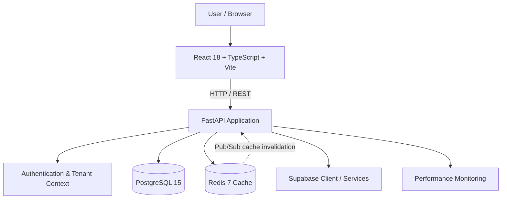

<div align="center">

# 🏡 PropertyFlow
### Multi-Tenant Property Management & Revenue Analytics

A full-stack platform for managing properties, reservations, operational workflows, and tenant-scoped revenue insights.

<p>
  
  
  
  
  
  
  
</p>

</div>

---

## ✨ Overview

**PropertyFlow** is a multi-tenant property management and revenue analytics application. It is designed around property management organizations that need to manage properties and reservations across different client accounts while keeping tenant data isolated.

The repository contains a React + TypeScript frontend, a Python FastAPI backend, PostgreSQL data storage, and Redis-backed caching. The local development environment is containerized with Docker Compose.

> **Engineering focus:** tenant isolation, timezone-correct revenue calculations, financial precision, cache consistency, API reliability, and operational visibility.

## 🚀 Application Areas

| Area | Description |
|---|---|
| **Dashboard** | Tenant-scoped property revenue summaries, reservation counts, and reporting filters. |
| **Properties** | Property records associated with their owning tenant and configured local timezone. |
| **Reservations** | Reservation data linked to both a property and its tenant. |
| **Cleaning assignments** | Frontend workflow area for operational cleaning tasks. |
| **Authentication & access** | Protected application routes, JWT-based authentication flows, and permission-aware user context. |
| **Profile & settings** | User profile and company configuration areas. |

## 🧱 Architecture



### Main components

| Component | Technologies | Responsibility |
|---|---|---|
| Frontend | React 18, TypeScript, Vite, Tailwind CSS | Application UI, protected routes, data views, and user workflows. |
| Backend | Python 3.11, FastAPI, Pydantic | REST endpoints, authentication flows, revenue services, and application logic. |
| Data access | SQLAlchemy, asyncpg, psycopg2 | Relational queries and PostgreSQL connectivity. |
| Database | PostgreSQL 15 | Tenants, properties, reservations, and related relational data. |
| Cache & messaging | Redis 7, Redis Pub/Sub | Revenue-summary caching and cross-worker authentication-cache invalidation. |
| Deployment | Docker, Docker Compose, Nginx | Local multi-service development and frontend serving. |

## 🔐 Engineering Highlights

### 1. Tenant-scoped data access

The data model associates properties and reservations with a `tenant_id`. The `properties` table uses a composite primary key of `(id, tenant_id)`, and reservations reference the matching property/tenant pair. This allows different tenants to use the same property identifier without conflating ownership.

For example, the seed data contains `prop-001` under both `tenant-a` and `tenant-b`, with different property names and timezones.

### 2. Tenant-aware Redis caching

Revenue summaries are cached with tenant and property identifiers in the cache key:

```text
revenue:{tenant_id}:{property_id}
```

When a month and year are requested, those values are also included in the key. Cached summaries use a five-minute TTL. Redis lookup and write failures are handled as cache failures so the revenue calculation can still be performed by the backend.

### 3. Timezone-aware revenue reporting

Revenue reporting evaluates reservation check-in timestamps in the property's configured timezone before applying monthly boundaries. PostgreSQL's `AT TIME ZONE` expression is used so that a reservation is attributed to the correct local reporting month rather than relying only on UTC dates.

### 4. Financial precision

Revenue calculations use Python's `Decimal` type and explicit `ROUND_HALF_UP` quantization for two-decimal output. The database schema stores reservation amounts using PostgreSQL `NUMERIC` rather than binary floating-point columns.

### 5. Operational visibility

The backend includes API performance middleware that records request duration, response status, user/tenant context when available, and cache-hit information. Health and database-pool status endpoints are also provided for local diagnostics.

### 6. Cross-worker cache invalidation

The backend includes a Redis Pub/Sub listener for authentication-cache invalidation messages, allowing worker processes to react to user-cache invalidations beyond their own in-memory process.

## 🛠️ Tech Stack

**Frontend**

- React 18 and TypeScript
- Vite
- Tailwind CSS
- React Router
- TanStack Query with persisted query state
- Supabase JavaScript client
- Chart.js / React Chart.js
- Radix UI, Carbon components, and Lucide icons

**Backend**

- Python 3.11
- FastAPI and Pydantic
- SQLAlchemy 2.x
- asyncpg and psycopg2
- Supabase Python client
- Redis async client

**Infrastructure & data**

- PostgreSQL 15
- Redis 7
- Docker and Docker Compose
- Nginx

## 📦 Getting Started

### Prerequisites

- [Docker](https://docs.docker.com/get-docker/)
- [Docker Compose](https://docs.docker.com/compose/)

### Run the application

```bash
# Clone the repository
git clone https://github.com/AARUSH-SING/New_devs_App.git

# Enter the project directory
cd New_devs_App

# Build and start the frontend, backend, database, and cache
docker compose up --build
```

Once the containers are running, open the following local services:

| Service | URL / Address |
|---|---|
| Frontend | [http://localhost:3000](http://localhost:3000) |
| Backend API | [http://localhost:8000](http://localhost:8000) |
| Interactive API docs | [http://localhost:8000/docs](http://localhost:8000/docs) |
| OpenAPI schema | [http://localhost:8000/openapi.json](http://localhost:8000/openapi.json) |
| PostgreSQL (host port) | `localhost:5433` |
| Redis (host port) | `localhost:6380` |

The Compose configuration initializes PostgreSQL using:

- `database/schema.sql` — database extensions and table definitions.
- `database/seed.sql` — sample tenants, properties, and reservations.

The database initialization scripts are applied when PostgreSQL initializes a new data directory.

### Useful commands

```bash
# Start services in the background
docker compose up --build -d

# View service status
docker compose ps

# Follow logs for all services
docker compose logs -f

# Follow a single service
docker compose logs -f backend

# Stop the services
docker compose down
```

## 🔎 API Reference

FastAPI exposes interactive documentation at `/docs` when the backend is running.

A key reporting endpoint is:

```http
GET /api/v1/dashboard/summary?property_id=prop-001&month=3&year=2024
```

It returns the revenue summary for the requested property in the authenticated tenant context. The `month` and `year` query parameters are optional and validated by the API.

The backend also exposes diagnostic routes, including:

| Endpoint | Purpose |
|---|---|
| `GET /health` | Application and database health check. |
| `GET /up` | Basic process availability check. |
| `GET /pool-status` | Database connection-pool status. |
| `GET /database-health` | Detailed database health information. |

## ⚙️ Configuration & Security Notes

The Docker Compose file contains development-oriented defaults to make local startup straightforward. **Do not use those defaults for a public deployment.** Before deploying or exposing the services outside a local development environment:

1. Replace development credentials and secret values with strong, unique values.
2. Keep database passwords, JWT secrets, Supabase keys, and third-party API keys out of source control.
3. Configure the allowed frontend origins and backend CORS policy for the deployment environment.
4. Use managed secrets or environment variables for sensitive configuration.
5. Review database access policies and tenant authorization behavior before using real customer data.

Backend settings are defined in `backend/app/config.py`, and the local service wiring is defined in `docker-compose.yml`.

## 🗂️ Repository Structure

```text
New_devs_App/
├── backend/
│   ├── app/
│   │   ├── api/              # FastAPI route modules
│   │   ├── core/             # Auth, tenant context, Redis and connection utilities
│   │   ├── models/           # Pydantic models
│   │   ├── services/         # Revenue and cache services
│   │   ├── monitoring/       # API and query performance monitoring
│   │   └── main.py           # FastAPI application entry point
│   ├── requirements.txt
│   └── Dockerfile
├── database/
│   ├── schema.sql            # PostgreSQL schema
│   └── seed.sql              # Development seed data
├── frontend/
│   ├── src/
│   │   ├── components/       # UI components and pages
│   │   ├── contexts/         # Application and auth context
│   │   └── ...
│   ├── package.json
│   ├── vite.config.ts
│   └── Dockerfile
└── docker-compose.yml
```

## 🧪 Frontend Development Commands

The frontend also provides the following npm scripts:

```bash
cd frontend
npm install
npm run dev       # Start the Vite development server
npm run build     # Create a production build
npm run lint      # Run ESLint
npm run preview   # Preview the production build
```

For running the backend directly on the host rather than through Docker, configure `DATABASE_URL` and `REDIS_URL` to point to the host-mapped ports (`5433` and `6380`) and provide the required application/Supabase settings for your environment.

## 🤝 Contributing

Contributions, bug reports, and technical feedback are welcome.

1. Fork the repository.
2. Create a focused branch for your change.
3. Include a clear description of the problem and the proposed solution.
4. Add or update tests where appropriate.
5. Verify the affected services locally before opening a pull request.

For larger changes, consider opening an issue first to discuss the approach.

## 🎥 Walkthrough

A walkthrough of the resolved issues is available here:

[Watch the project walkthrough](https://drive.google.com/file/d/1aTU41IZWuGG7c9luTE66z2ggJKmR-k6c/view?usp=sharing)

## 👤 Maintainer

**Aarush Singh**  
[GitHub: @AARUSH-SING](https://github.com/AARUSH-SING)

---

<div align="center">

**Built with a focus on reliable data, tenant isolation, and practical developer experience.**

</div>
